# Authentication & Onboarding — the complete user guide

This manual walks through every screen of the Drevanta server console:
first-time setup, multi-factor authentication, recovery codes, sign-in,
the three ways back in when you are locked out, and day-to-day account
management. Every step documents the success state **and** the failure
states you can meet along the way.

**How to read the screenshots.** Every step shows one *pair of
equal-sized images* — desktop on the left, mobile on the right — with a
single shared caption underneath. Desktop shots are 1440×900, mobile
shots 390×844; the console is fully responsive, and both views come
from v0.4.18.

---

## The journey at a glance

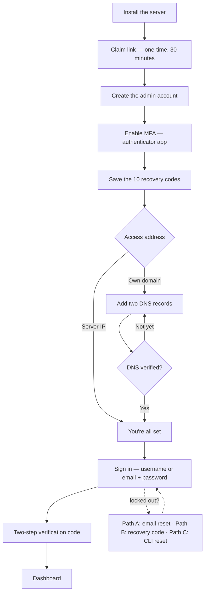

---

## Contents

1. [First-time setup — the claim link](#1-first-time-setup--the-claim-link)
2. [Create the admin account](#2-create-the-admin-account)
3. [Enable multi-factor authentication](#3-enable-multi-factor-authentication)
4. [Save the recovery codes](#4-save-the-recovery-codes)
5. [Choose the address — server IP or your domain](#5-choose-the-address--server-ip-or-your-domain)
6. [You're all set — the completion checklist](#6-youre-all-set--the-completion-checklist)
7. [Signing in — two steps](#7-signing-in--two-steps)
8. [Sign-in failure states](#8-sign-in-failure-states)
9. [Locked out? Three ways back in](#9-locked-out-three-ways-back-in)
10. [Managing the account — Settings](#10-managing-the-account--settings)
11. [Security — what is enforced](#11-security--what-is-enforced)
12. [Troubleshooting](#12-troubleshooting)

---

## 1. First-time setup — the claim link

**What happens.** After installation the daemon prints a **one-time
setup link**:

```text
https://<your-server>/onboarding#token=drv1_…
```

**What you do.** Open the link in a browser. It works exactly once,
expires after 30 minutes, and is accepted only while no administrator
exists. You can also enter a token manually: open `/onboarding` without
the link and paste the `drv1_…` token.

| Desktop | Mobile |
|:---:|:---:|
| 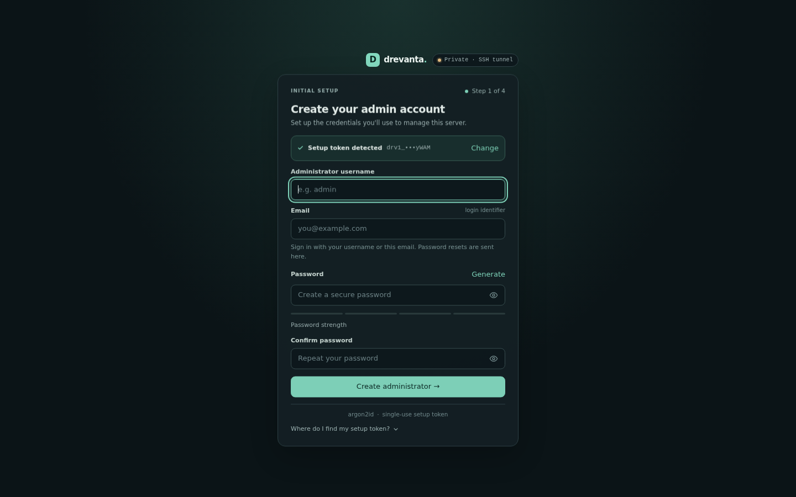 | 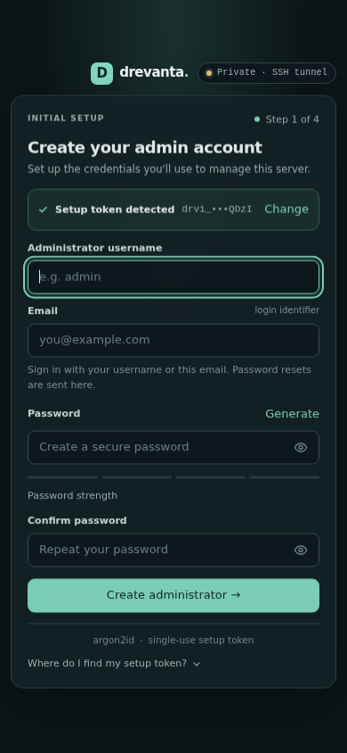 |

*Claim screen with the token detected from the pasted link.*

**Failure states**

| Symptom | Meaning | Fix |
|---|---|---|
| "token expired" | more than 30 minutes passed | run `sudo drevanta claim regenerate` on the server |
| "token used" | somebody already finished setup | sign in instead |
| "token invalid" | the token was rotated or mistyped | copy the whole link again |

> [!IMPORTANT]
> The token lives only in the browser tab until you submit — it is
> never stored in cookies, localStorage or logs.

---

## 2. Create the admin account

**What you do.** Pick a **username** (3–32 characters), an **email**,
and a **password** (12–128 characters). The email is a second login
identifier — you can sign in with the username *or* the email — and the
target for password-reset links later. The strength meter reacts live;
a Caps-Lock warning appears while typing.

**Failure states.** A too-short password ("Needs N more characters"),
a mismatched confirmation ("Passwords do not match yet."), a username
with invalid characters, or a missing/invalid email. Nothing is sent to
the server until every field passes — the first invalid field is
focused for you.

---

## 3. Enable multi-factor authentication

**What happens.** The console asks for an authenticator app (Aegis,
1Password, Google Authenticator, …) and shows a QR code to scan. If you
cannot scan, the setup key can be entered by hand — it is collapsed by
default so it does not shoulder-surf:

| Desktop | Mobile |
|:---:|:---:|
| 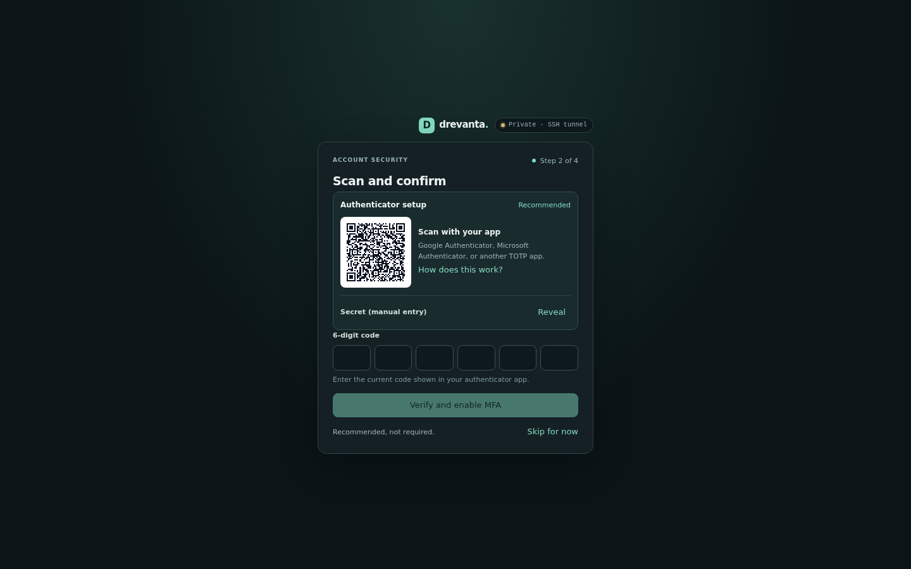 | 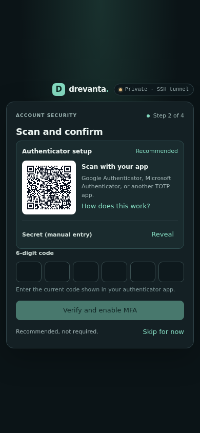 |

*The setup key is collapsed by default; "Reveal" shows the whole field, and "How does this work?" opens step-by-step instructions below the QR code.*

| Desktop | Mobile |
|:---:|:---:|
| 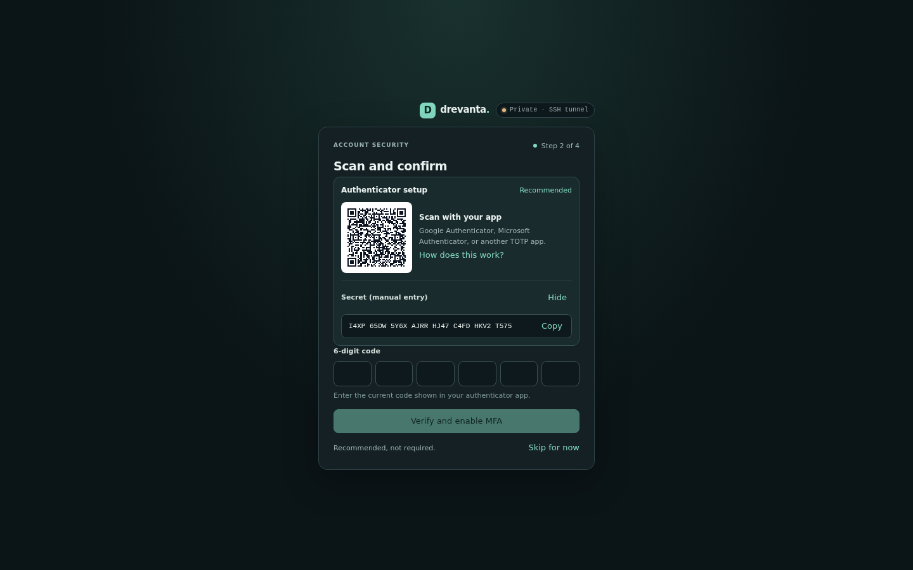 | 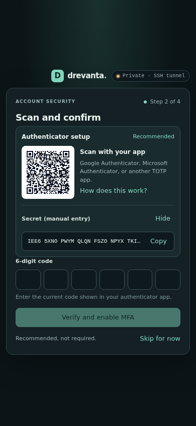 |

*The revealed setup key; "Hide" collapses it again.*

**What you do.** Enter the current 6-digit code and confirm.

**Failure state.** "invalid authenticator code" — usually a code that
just rolled over, or device/server clock drift. Wait for the next code
and try again; check NTP on the server if it keeps failing.

MFA can be skipped ("Skip for now") with an explicit risk
acknowledgement:

> [!WARNING]
> Skipping leaves the account protected by password only. MFA can be
> enabled later under Settings → Account security.

---

## 4. Save the recovery codes

**What happens.** After verification the console shows **10 single-use
recovery codes**. They are displayed exactly once, and you must confirm
they are stored before continuing. Each code signs you in once when the
normal path fails (see [section 9](#9-locked-out-three-ways-back-in)).
Regenerating the set later invalidates all previous codes.

| Desktop | Mobile |
|:---:|:---:|
| 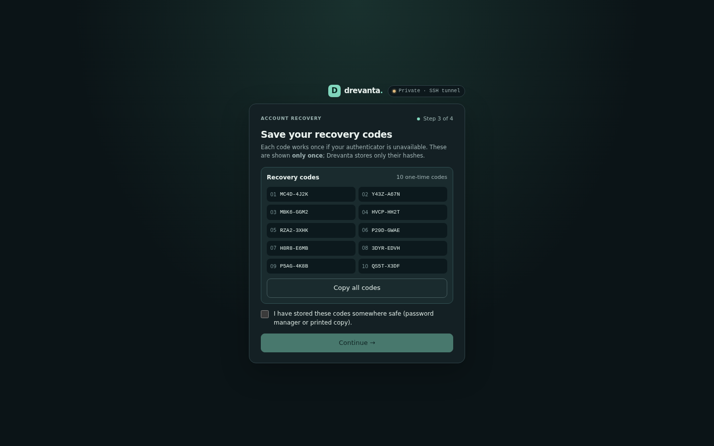 | 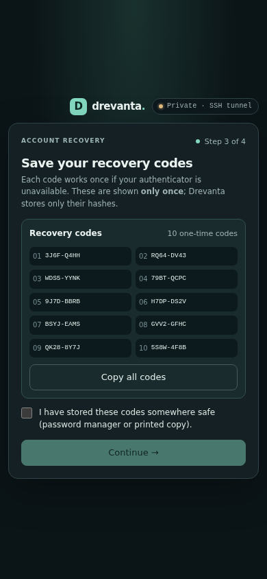 |

*The ten recovery codes, shown exactly once, with the storage confirmation.*

> [!TIP]
> Store the codes offline — a password manager or printed paper, not a
> screenshot in the same cloud as the server.

---

## 5. Choose the address — server IP or your domain

**What happens.** The console is reachable over the server IP with a
publicly trusted certificate, or under your own domain. Choosing
"I have a domain" → "Set up your domain" asks for the hostname, shows
the exact DNS records to create, and verifies before switching
anything:

| Desktop | Mobile |
|:---:|:---:|
| 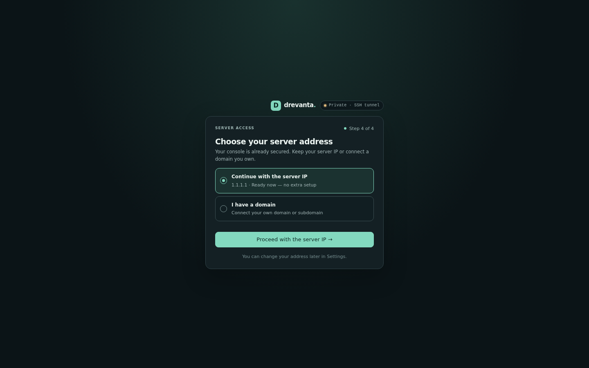 | 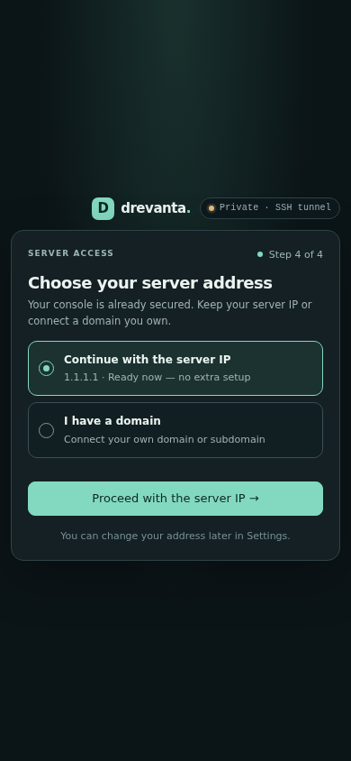 |

*The address step with the two DNS records to create.*

**Failure state — "Domain not connected yet".** The DNS records were
not found or do not point at this server yet. The panel shows both
records with Copy buttons; DNS changes can take minutes to hours. The
server-IP address keeps working the whole time, and you can skip:

| Desktop | Mobile |
|:---:|:---:|
| 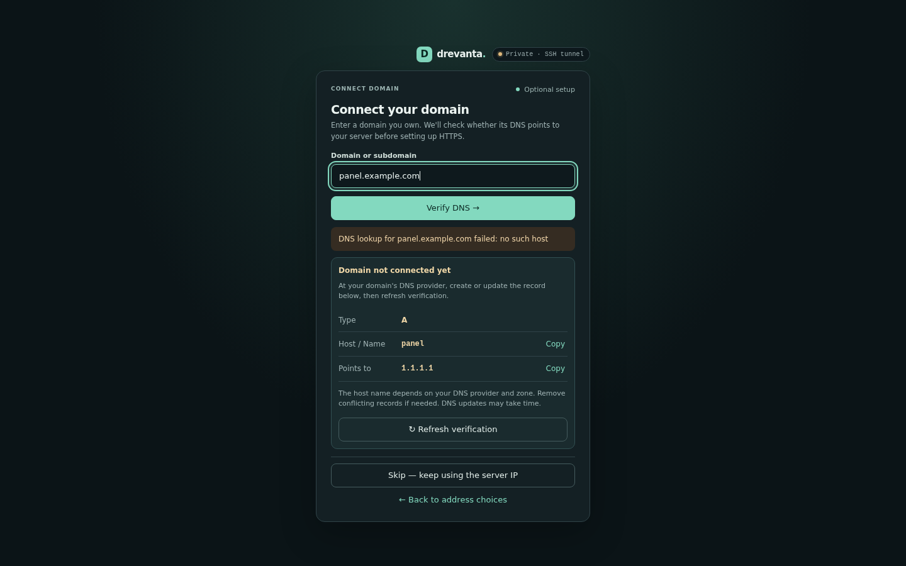 | 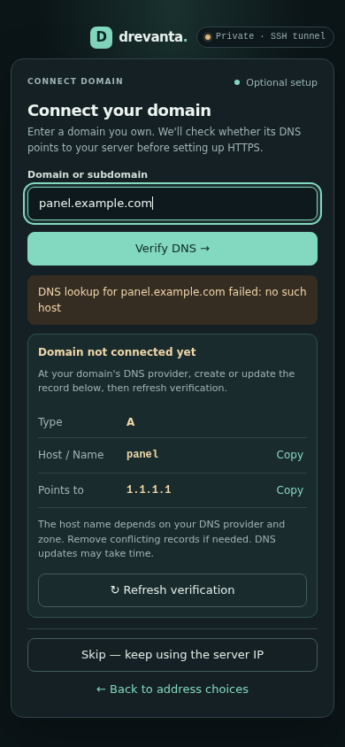 |

*"Domain not connected yet" — verification failed, the IP address is untouched.*

> [!NOTE]
> The certificate is issued only after DNS verifies, and any failure
> leaves the IP address untouched — fail-safe by design.

---

## 6. You're all set — the completion checklist

**What happens.** The final screen summarises what was configured —
admin credentials, MFA, account secured, address/domain — with live
CPU, memory and disk readings, and links back to the domain
configuration if you skipped it:

| Desktop | Mobile |
|:---:|:---:|
| 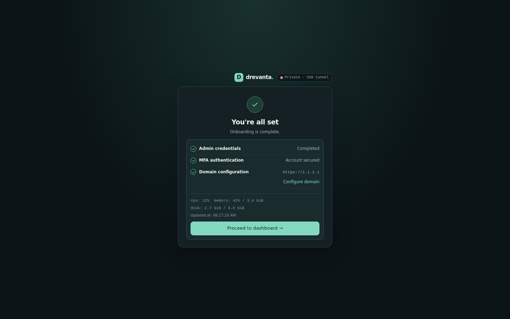 | 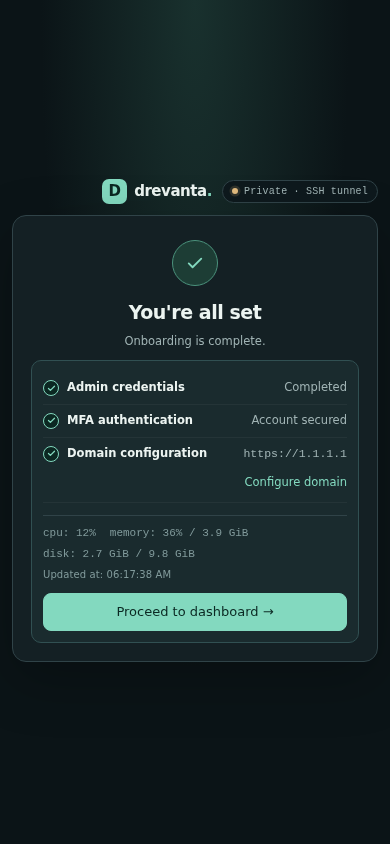 |

*The completion checklist with live server readings.*

**What you do.** "Proceed to dashboard" signs you in. A paused
onboarding (browser closed mid-way) resumes where you left off when
you sign in again.

---

## 7. Signing in — two steps

**Step 1 — credentials.** Sign-in works with **username or email** plus
password. The password field has a Show/Hide toggle and is masked by
default:

| Desktop | Mobile |
|:---:|:---:|
| 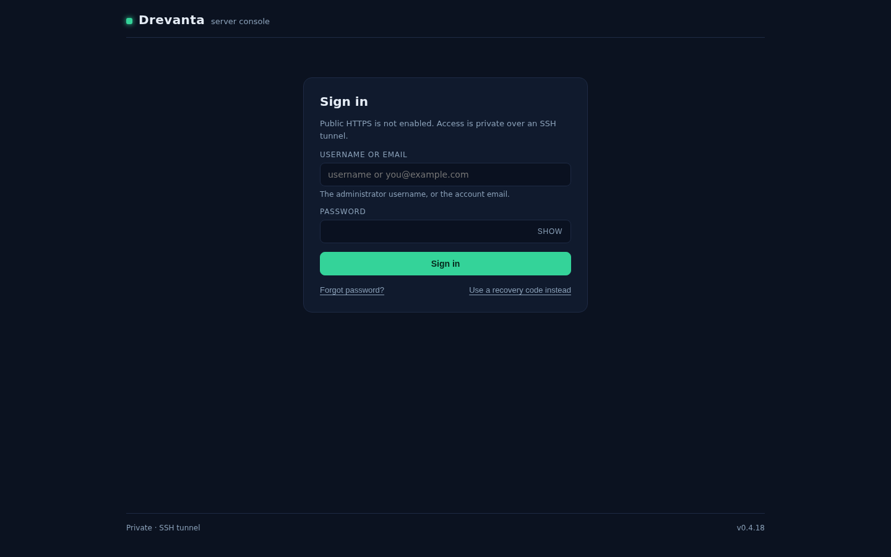 | 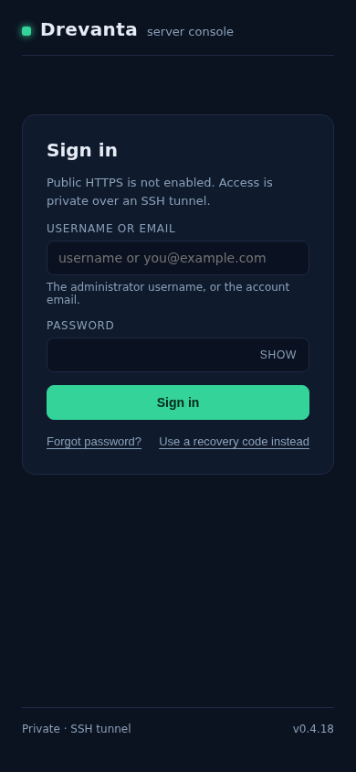 |

*Step 1 — username/email and password, masked by default.*

| Desktop | Mobile |
|:---:|:---:|
| 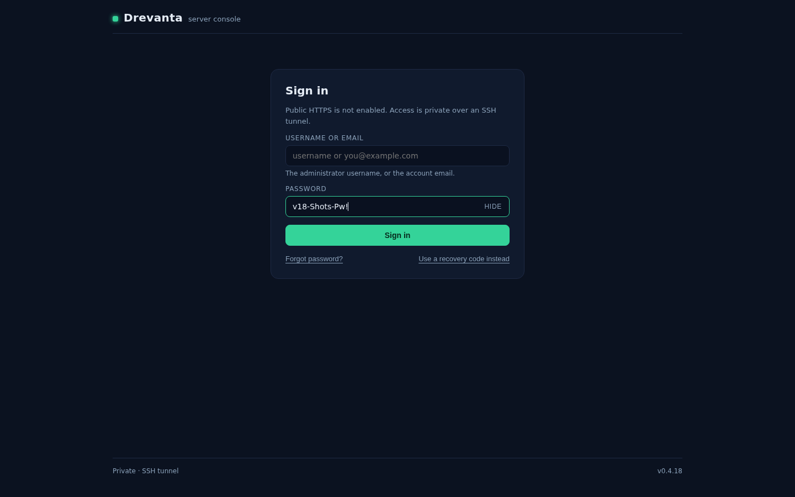 | 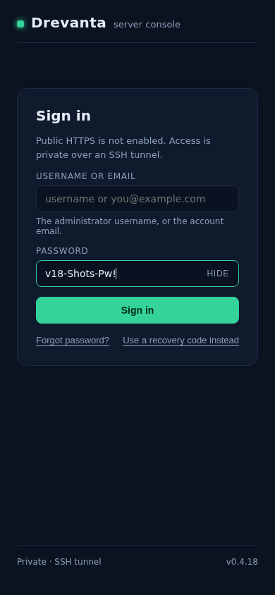 |

*The same field with "Show" pressed — handy on a keyboardless tablet.*

**Step 2 — the code.** When MFA is enabled the console switches to its
own **Two-step verification** screen — the code field only,
autofocused:

| Desktop | Mobile |
|:---:|:---:|
|  |  |

*Step 2 — the dedicated two-step screen, nothing else on it.*

The screen survives a full page reload:

| Desktop | Mobile |
|:---:|:---:|
| 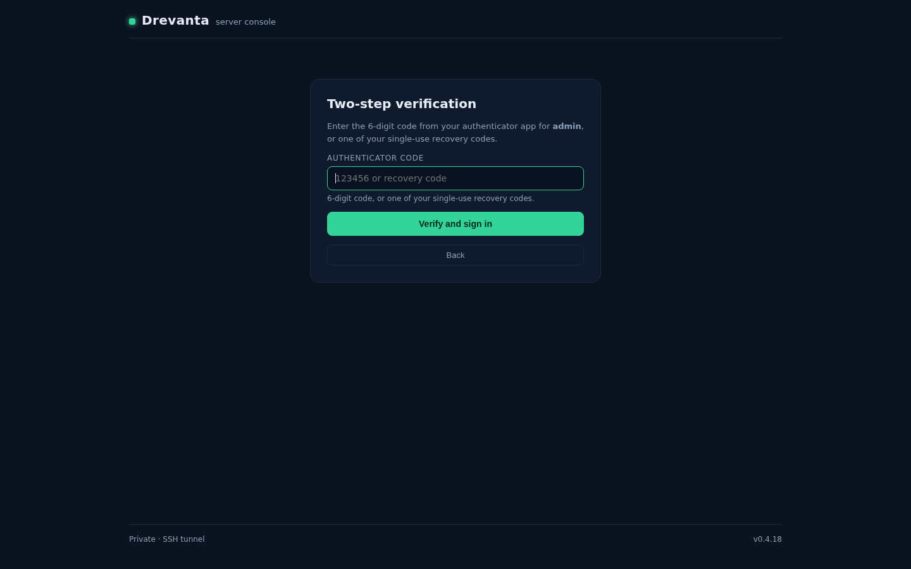 | 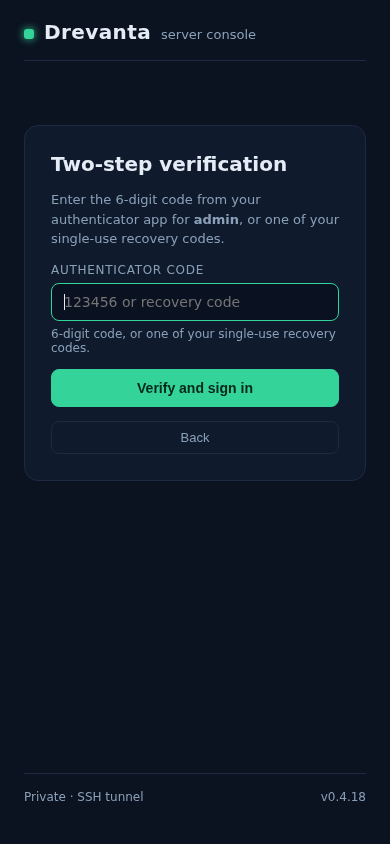 |

*After a reload the console is still on the code step — the password is never asked again. On a phone, switching to your authenticator app and back is safe: the reload phones often trigger does not lose your place.*

The code field accepts the 6-digit code **or** one of the recovery
codes. After the code verifies, the dashboard opens.

---

## 8. Sign-in failure states

| Screen | What happened | What to do |
|---|---|---|
| "invalid username or password" | wrong credentials at step 1 | retry; the username/email must match exactly |
| "invalid authenticator code" | wrong 6-digit code | wait for the next code |
| "too many attempts, slow down" | more than 10 sign-in attempts per minute from your address | wait a minute |
| "too many failed attempts for this account — wait a few minutes" | 10 failed attempts against the account in 15 minutes (from any address) | wait 5 minutes; then recovery paths below |
| "this sign-in attempt expired" | the two-step challenge sat for 5 minutes unused | sign in again |

| Desktop | Mobile |
|:---:|:---:|
| 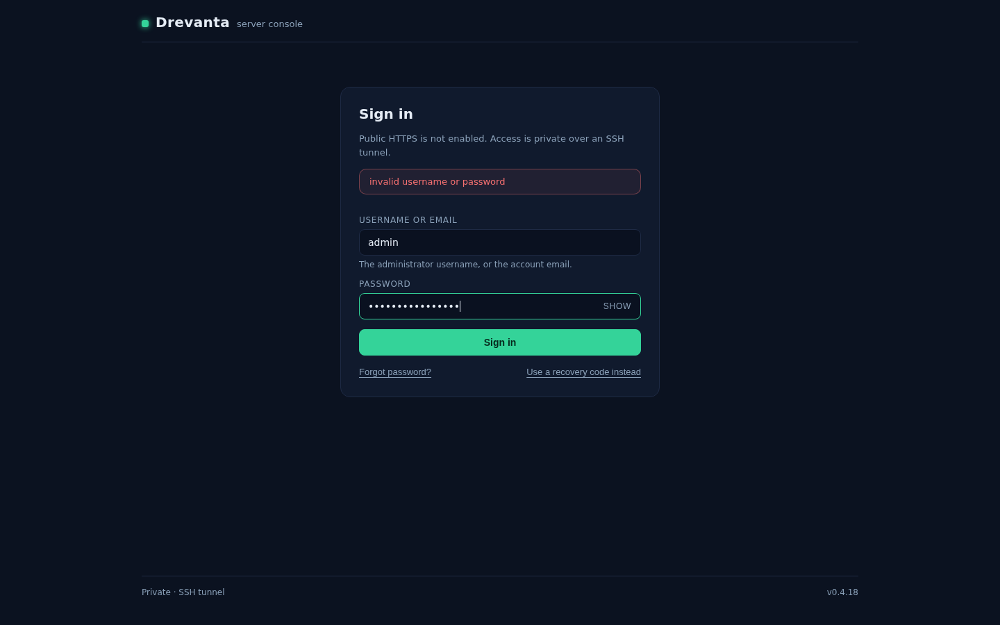 | 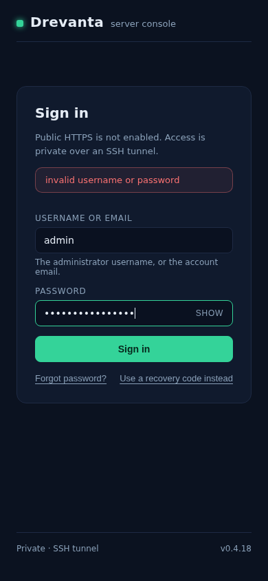 |

*A wrong password keeps you on step 1 — the error is constant, with no hint which field was wrong.*

| Desktop | Mobile |
|:---:|:---:|
| 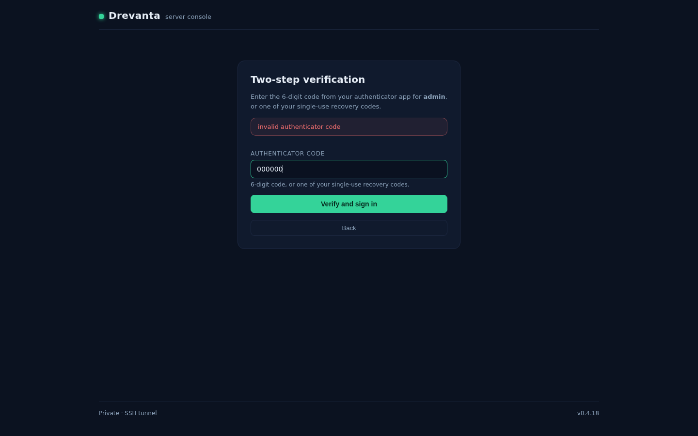 | 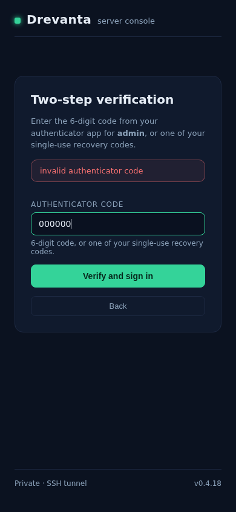 |

*A wrong code keeps you on the two-step screen — just wait for the next one.*

---

## 9. Locked out? Three ways back in

### Path B — recovery-code sign-in (no password needed)

"Use a recovery code instead" on the sign-in screen: username/email +
one of your saved codes. The code replaces both factors for this one
sign-in and lands on a forced "Set a new password" screen — after
saving, you are on the dashboard with a fresh password.

| Desktop | Mobile |
|:---:|:---:|
| 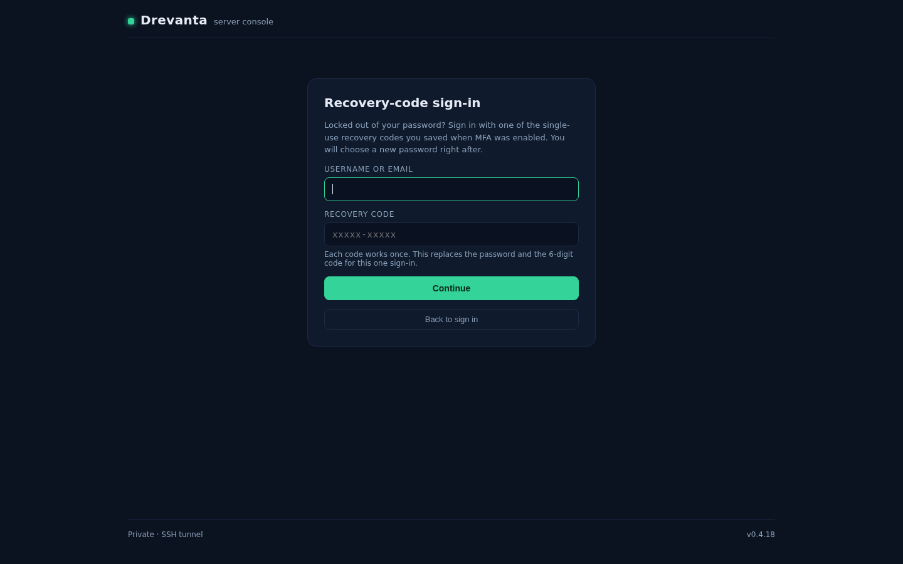 | 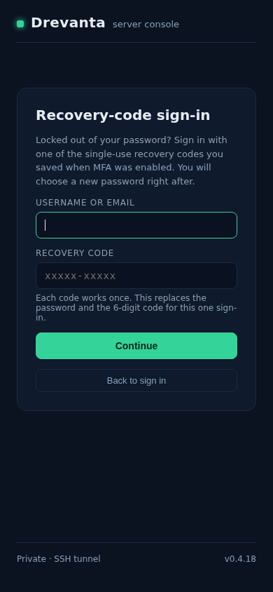 |

*Path B — the recovery-code field in place of the password.*

### Path A — email reset link (needs SMTP configured)

"Forgot password?" asks for your username or email. If the account has
an email and mail delivery is configured (Settings → Email delivery),
a **single-use link** valid for 30 minutes is sent:

| Desktop | Mobile |
|:---:|:---:|
| 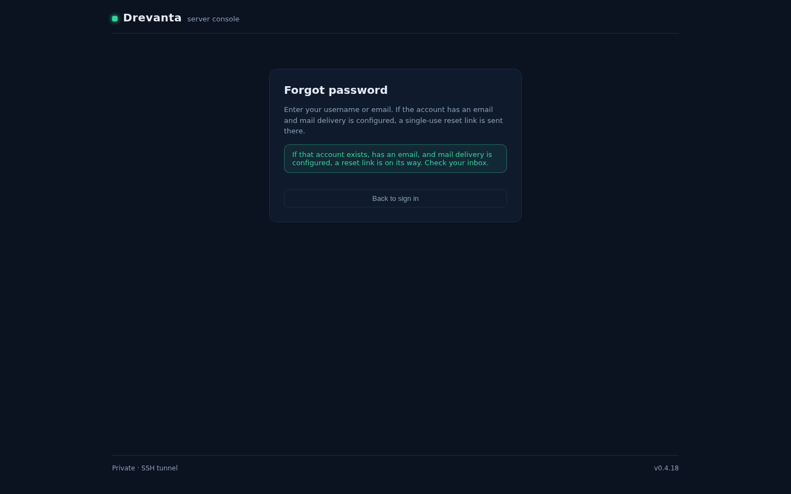 | 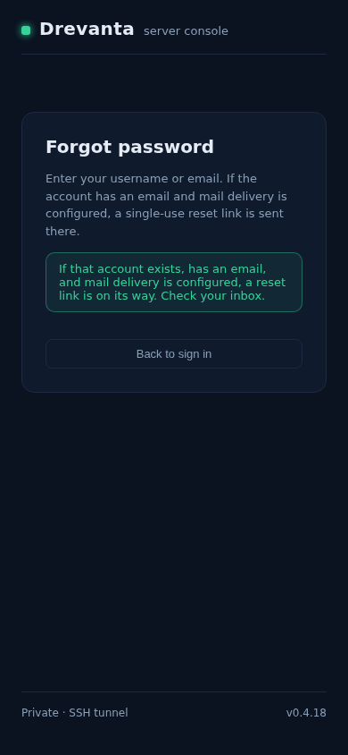 |

*Path A — the reset request form.*

The response is the same whatever you type — nobody can probe whether
an account exists. Opening the link shows the reset screen; completing
it signs out every existing session.

| Desktop | Mobile |
|:---:|:---:|
| 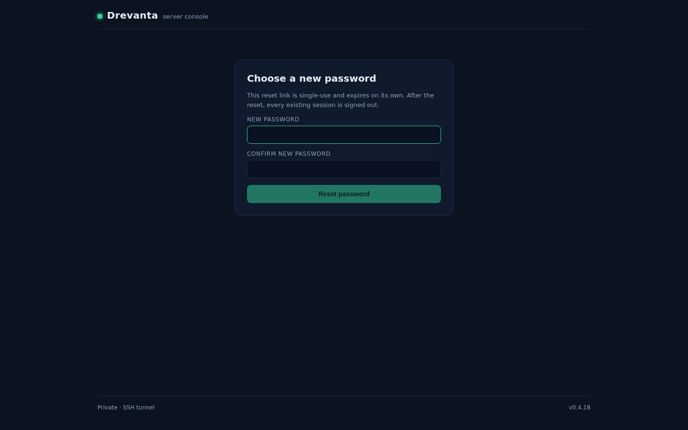 | 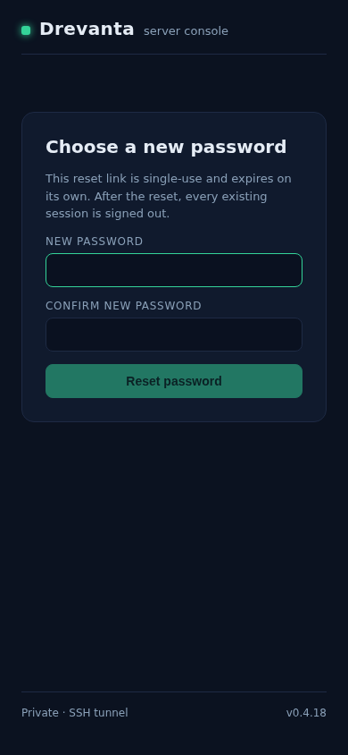 |

*The reset screen reached from the emailed link.*

### Path C — break-glass CLI (root on the server)

If email is down and the codes are lost, root access always wins:

```text
sudo drevantad admin reset-password            # prompts twice, input hidden
sudo drevantad admin reset-password --username admin --password '…'
```

It validates the password policy, ends all sessions and writes an
audit event.

### Last resort

> [!WARNING]
> Lost password, codes, email **and** SSH access cannot be recovered by
> design — reinstall and re-claim (`sudo drevanta claim regenerate`
> works only before the first owner exists). This is the trade-off of a
> self-hosted, single-admin console.

---

## 10. Managing the account — Settings

Settings holds four groups: **Account** (email + password), **Email
delivery** (SMTP), **Account security**, and **Access address**.

| Desktop | Mobile |
|:---:|:---:|
| 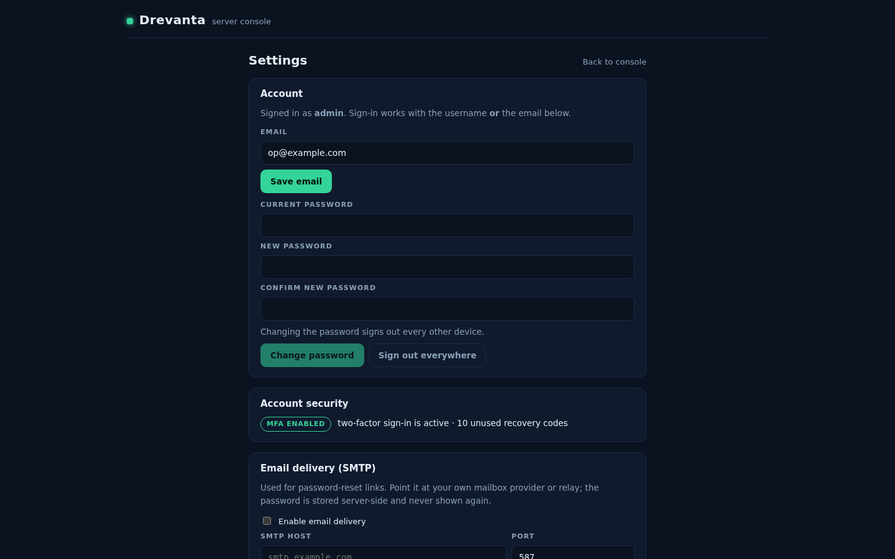 | 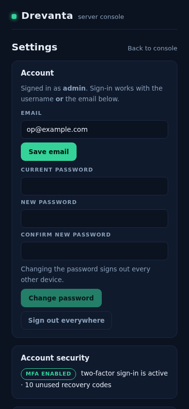 |

*Settings — account, mail delivery, security and access address.*

- **Email** — change or clear it; sign-in falls back to username-only
  when cleared. Uniqueness is enforced case-insensitively.
- **Change password** — requires the current password; every OTHER
  device is signed out (the count is shown).
- **Sign out everywhere** — ends all sessions including this one.
- **Email delivery (SMTP)** — host, port (implicit TLS on 465, STARTTLS
  otherwise), credentials and From address, plus a "Send test message"
  button that reports sender errors verbatim. The password is stored
  server-side and never displayed again.
- **Account security** — enable MFA later or regenerate recovery codes.
- **Access address** — add/remove the custom domain; warns when the
  certificate has ≤ 14 days left.

The dashboard you land on after sign-in:

| Desktop | Mobile |
|:---:|:---:|
| 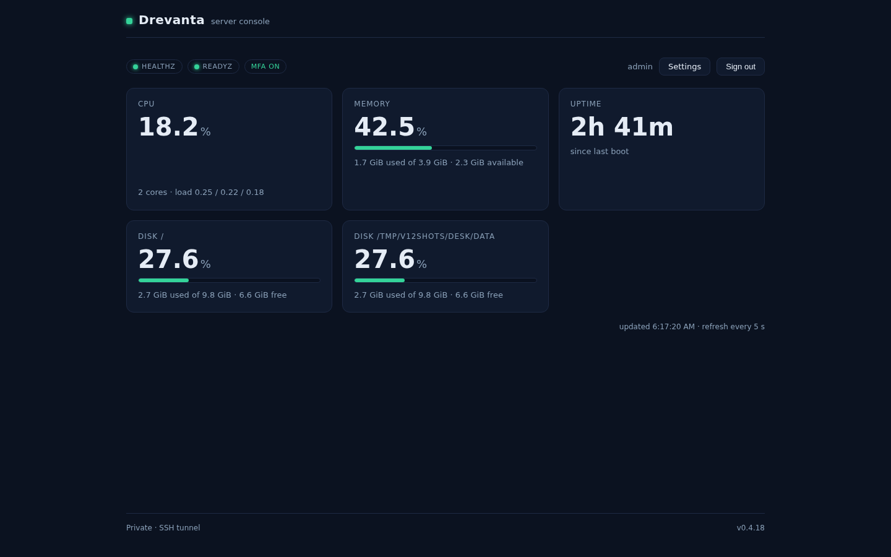 | 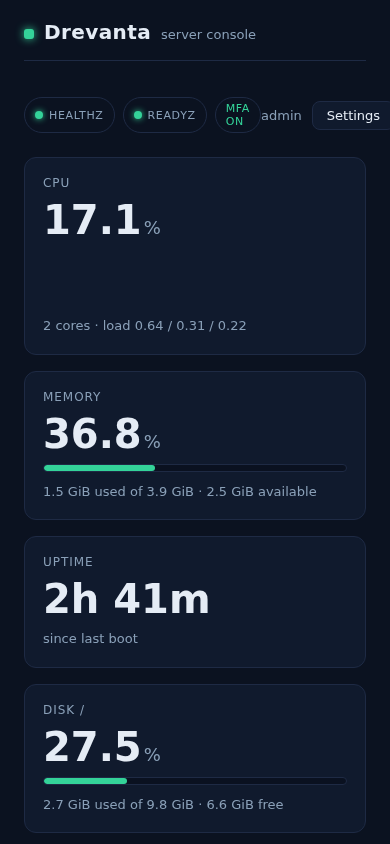 |

*The dashboard with live server readings.*

---

## 11. Security — what is enforced

**Credentials and sessions**

- Argon2id password hashing (memory-hard), 12–128 character policy.
- Two-step sign-in: the password is verified before any code is asked.
- A stolen "sign-in attempt" token grants nothing — it is single-use,
  expires in 5 minutes, allows at most 5 wrong codes and is stored
  hashed, in memory only.
- Session cookies: HttpOnly, SameSite=Lax, `Secure` on HTTPS, random
  256-bit tokens stored hashed; sliding 24-hour expiry with a hard
  7-day cap; ended on logout, password change and reset.

**Abuse resistance**

- Per-address rate limits: login and recovery 10/min (tunable via
  `DREVANTA_RATE_LIMIT`), separate buckets for claim/MFA endpoints.
- Per-account lockout: 10 failures in 15 minutes → 5-minute lockout,
  independent of source address.
- Constant "invalid username or password" responses — no account
  enumeration on login or password reset.
- Bounded Argon2 concurrency (memory-exhaustion guard) and 16 KiB JSON
  body caps; the HTTP servers run read/write/idle timeouts.

**Transport and browser hardening**

- Public HTTPS with automatic Let's Encrypt certificates (renewal
  monitored; console warning at ≤ 14 days); the backend stays
  loopback-only.
- Content-Security-Policy pinned to 'self', `X-Frame-Options: DENY`,
  `Referrer-Policy: no-referrer`, Permissions-Policy (camera, mic,
  geolocation, payment off), `X-Content-Type-Options: nosniff`, HSTS.
- Same-origin checks on every state-changing request.
- HTML shells are `no-store` — stale bundles cannot mask an update.

**Data**

- All SQL uses parameterised queries (no string-built SQL); SQLite in
  WAL mode with foreign keys on.
- Claim tokens, session cookies, recovery codes and password-reset
  tokens exist only as SHA-256 hashes in the database.
- An audit log records logins (with reasons), MFA changes, recovery-code
  use, email/password changes, resets and lockouts.
- Nightly `VACUUM INTO` snapshots of the database, last 7 kept in
  `/var/lib/drevanta/backups`.

**What the operator should do (server-side)**

- Keep SSH key-only with fail2ban; apply unattended security updates.
- Ensure NTP is active (TOTP depends on the clock).
- Copy the nightly backup off the box; test the restore path:
  stop units → copy snapshot over `/var/lib/drevanta/drevanta.db` →
  start units.
- Configure SPF/DKIM/PTR for the mail domain so reset links arrive.

---

## 12. Troubleshooting

| Symptom | Likely cause | What to do |
|---|---|---|
| Codes always rejected | server clock drift | enable NTP/chrony; "check the clock" is also shown in the UI |
| Reset mail never arrives | SMTP misconfigured or spam-foldered | Settings → Email delivery → "Send test message"; check SPF/DKIM |
| "Domain not connected yet" for hours | DNS not propagated or wrong records | re-check the two records (Host / Points to); TTL up to hours |
| Locked out, no email, no codes | — | Path C CLI reset from SSH |
| Old UI after an update | browser cache | hard refresh (Ctrl+Shift+R); shells are no-store since 0.4.11 |
| Certificate warning in Settings ≤ 14 days | renewal pending/failing | watch `sudo drevanta access status`; renewal is automatic |

---

*Manual for Drevanta v0.4.18. Screenshots live in `docs/images/` — in
every pair the desktop shot (`desk-…`) is on the left, the mobile shot
(`mob-…`) on the right.*
